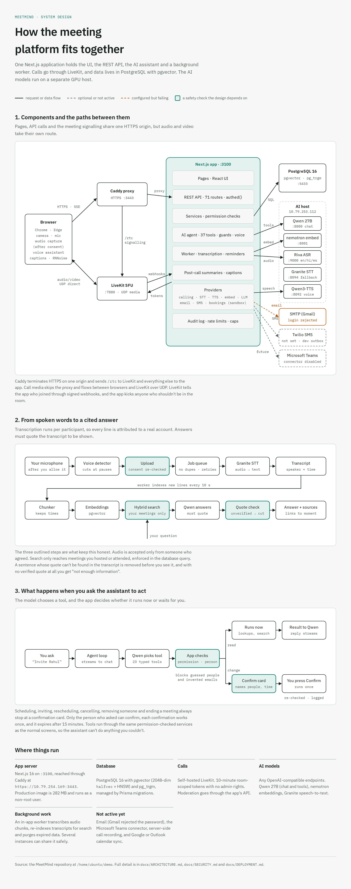

# MeetMind

A standalone video-meeting platform with an AI meeting assistant. You can sign in, start or schedule calls, invite colleagues by name, transcribe meetings with each participant's consent, summarise them, and ask questions that are answered from the transcripts with citations.

It works on its own, without Microsoft Teams. A Teams connector can be added later behind the same provider interface; see [docs/TEAMS_CONNECTOR.md](docs/TEAMS_CONNECTOR.md).

| Layer | Technology |
|---|---|
| Web app + REST API | Next.js 16 (App Router, TypeScript), Tailwind v4, shadcn/ui, Lucide |
| Database | PostgreSQL 16 + pgvector (`halfvec(2048)`, HNSW) + pg_trgm, Prisma 7 |
| Auth | Built-in: bcrypt, opaque DB-backed sessions, workspace and meeting roles, guest accounts |
| Calls | LiveKit (self-hosted, or LiveKit Cloud) |
| AI | Any OpenAI-compatible endpoints. Developed against Qwen `qwen3.8-27b` (chat and tools), `llama-nemotron-embed-1b-v2` (embeddings) and `granite-speech-4.1-2b` (speech-to-text) |



## Feature status

All 16 phases are complete, including a second security review (Phase 12, see [SECURITY.md](docs/SECURITY.md)). The assistant is a team of 8 agents: a coordinator, five specialists, a general agent and a planner.

| Area | What works |
|---|---|
| Accounts | Sign-up/login, workspaces with join codes, roles, profile and time zone, searchable directory that flags same-name people, guest accounts for external invitees, workspace switching |
| Calls | Real audio/video via LiveKit, screen sharing, device selection, participant list, chat, duration and connection status. Host controls: mute, remove, co-host, end. Invite from inside the call. **Styled as a phone call**, not a video-meeting grid: each person is a large round avatar (camera inside the circle when it's on) with a ring that pulses while they talk and the language they picked, translations as large subtitles, and round labelled keys with a big red End key in the middle |
| Calling (Phase 8) | One-tap **voice** or **video** calls from the directory or the assistant ("call Rahul"). An incoming-call screen with a ringtone on any page, plus accept, decline and missed-call notifications. People added to a live call get rung. **Voice cancellation:** off, standard (browser) or enhanced (RNNoise AI noise removal). Preferred language and mobile number in the profile |
| Voice assistant (Phase 9) | Talk to the assistant during a call: push-to-talk, or say **“Hey Mind, …”** with listening turned on. Real speech recognition (NVIDIA Parakeet via Riva, in the 12 call languages), spoken replies **streamed sentence by sentence** (NVIDIA Magpie TTS, first audio in about 0.05 s; Qwen3-TTS and the browser voice as fallbacks), and spoken yes/no confirmations. The assistant chat's mic is **hands-free**: it stays on until you turn it off, and answers aloud. Speech without the wake phrase is discarded. A spoken notice when transcription starts |
| Live translated captions (Phase 10) | Subtitles over the call in **your** language: choose Hindi, Tamil, Spanish and 11 others, or captions as spoken. Speech is translated by the LLM as it's transcribed, cached so every viewer of a language shares one translation, and the original is one hover away |
| Reminders & tasks (Phase 11) | “Remind me at 5 to call Priya”: reminders in-app and by **SMS** to your verified number (Twilio, or a dev outbox). Order **food**, book a **cab** or reserve a **table** by asking the assistant, with a confirmation showing the items and price first. These use a clearly labelled **sandbox** provider: no real orders. “Set up the meeting we just agreed on” turns the last few minutes of a call into a scheduled meeting. After each call: an automatic summary, notifications, and reminders for your action items. A **Tasks** page lists it all |
| Agent team (Phase 13) | Orchestrated with **LangGraph** (turn graph: coordinator → specialists; each specialist a model ⇄ tools graph). The assistant is a **coordinator plus specialist agents**: Meetings & calls, Meeting knowledge, Food & dining, Travel and Reminders, plus a General agent. Each specialist has its own focused instructions and only its own tools. Multi-part requests (“schedule a review with Priya and book a table right after it”) are split and handed from agent to agent, and the chat shows which agent is working |
| Planner agent (Phase 14) | Give it a goal (“plan a team dinner Friday for Priya, Amit and me at The Green Bowl, with a cab from the office”). It researches calendars, tables and fares, then shows **one plan** listing every exact action and price for a single approval. It carries the plan out and, if a step fails (say the table filled up), proposes a revised plan for just that part. It never invents addresses or pickup points |
| AI interpreter (Phase 15) | **Real-time voice translation in calls.** A host turns on the AI interpreter and it joins the call as a participant. Each person picks their language (English, Hindi, Spanish) and **hears everyone else spoken in their own language**, with the original voices turned down. A live panel shows the original and translated text and the latency of each line; the meeting page has a latency report (average, median, 95th percentile). It works in conference calls too: each listener gets their own language. Run it with `npm run interpreter` Each speaker picks the **voice and tone** everyone hears them in (e.g. Sofia · Calm, Jason · Happy), with a preview. |
| Call summary & delivery (Phase 16) | Upload a call recording (or click **Try a sample call**): the whole call is transcribed with **speakers told apart** (Speaker 1, Speaker 2…, renameable), with talk time per speaker. An AI summary (key points, decisions, action items, open issues, each linked to the moment it was said) is made automatically and **delivered** to everyone in the call: in the app, by email, and by SMS if they opt in. A delivery panel shows each person and channel with its status |
| Noise cancellation demo (Phase 17) | **Demos → Noise cancellation**: pick a noisy sample (office, street, café) or upload your own, run RNNoise, GTCRN and Speex side by side, and compare before/after by ear, by spectrogram and by number (SI-SDR gain and background reduction). Office noise: GTCRN +9.6 dB SI-SDR and 23.6 dB less background; RNNoise +7.4 dB / 22.7 dB |
| Ordering and booking agent (Phase 17) | Ask, by typing or **by voice** (mic button, replies spoken back), to order pizza from **Slice Republic** or book **movie tickets**. A Movies agent finds films and showtimes, picks the best seats together, asks for anything missing, and shows the exact seats and price for confirmation. Confirmed orders appear in **sandbox partner portals** (a restaurant order screen and a cinema box office) that move through each stage live. A **Demos** page links all four POC demos |
| Call languages (since 2026-10-24) | Calls use **NVIDIA Parakeet** (speech recognition) and **NVIDIA Magpie TTS Multilingual** (voice) in **12 languages**: English, Hindi, Spanish, French, German, Italian, Portuguese, Chinese, Japanese, Korean, Arabic and Vietnamese. Translation is done by Qwen. Measured: Hindi → French 1.4 s end to end, English → Hindi 2.3 s, Hindi → English 3.0 s. The earlier Indic speech stack (22 Indian languages) is switched off; its code stays and returns if the `INDIC_*` settings are set again |
| Scheduling | Schedule, reschedule and cancel with DST-correct time zones. Conflict detection with an explicit override. "Find a time" across working hours. RSVP. Week calendar. In-app notifications. `.ics` email invites when SMTP works |
| AI assistant | Natural-language requests use 23 typed tools. Asks which person when names are ambiguous. Confirmation before scheduling, inviting, rescheduling, cancelling, removing or ending. Server-side guards against invented people, emails or claims |
| Transcription | Host turns it on and everyone sees a banner. Each person's audio is captured only after **they** allow it. Live transcript. Recording-upload and VTT/SRT/text import fallbacks. Search, export (TXT/VTT/SRT/JSON), retention and deletion |
| Summaries | Decisions, action items (owner and due date) and open issues, each cited to a transcript time. Uncited items are dropped |
| Q&A | Search page, "Ask about this meeting", and the assistant. Hybrid retrieval over meetings you attended; verified quotes; "not enough information" when it isn't there |
| Ops | Admin Integrations panel with live health checks, audit logs, Docker images, production compose with auto-HTTPS |

**Definition of done:** every item is verified by browser tests against the production build: sign in, create or join a real call, invite a registered user, schedule a meeting, get a transcript, summarise it, and ask grounded questions.

## Quick start (development)

You need Node 20+ (tested on 24) and Docker.

```bash
cp .env.example .env                                # fill ENCRYPTION_KEY, LiveKit keys, AI endpoints
npm install
docker compose up -d                                # Postgres+pgvector on :5433
npm run db:migrate && npm run db:seed               # schema + demo users (dev only)

cp infra/livekit.example.yaml infra/livekit.yaml    # set key/secret (= .env) and node_ip = this machine's LAN IP
scripts/dev-cert.sh <server-ip>                     # self-signed cert for local HTTPS
docker compose --profile livekit up -d              # LiveKit + Caddy HTTPS proxy on :3443

npm run dev                                         # or: npm run build && npm start
```

Open **`https://<server-ip>:3443`** and accept the self-signed certificate once. Browsers only allow camera and microphone on HTTPS (or `localhost`).

**Demo accounts** (all use password `MeetMind#2026`):

| Workspace (join code) | Users |
|---|---|
| Acme Corp (`acme-demo`) | `aisha@acme.test` (owner), `priya@acme.test` (admin), `rahul.sharma@acme.test` and `rahul.s@acme.test` (two people named Rahul Sharma), `rahul.verma@acme.test`, `amit@acme.test` |
| Globex (`globex-demo`) | `hank@globex.test`, `rahul@globex.test` (cross-workspace isolation) |

## Commands

| Command | Purpose |
|---|---|
| `npm run dev` / `npm run build && npm start` | App on :3100 (use the HTTPS proxy on :3443) |
| `npm test` | Unit and integration tests (uses `TEST_DATABASE_URL`) |
| `LLM_LIVE=1 npx vitest run tests/live` | Live evaluation against the real AI models |
| `npx playwright test` | Browser end-to-end tests; see [docs/TESTING.md](docs/TESTING.md) |
| `npm run typecheck` / `npm run lint` | Static checks |
| `npm run db:migrate` / `npm run db:seed` / `npm run db:studio` | Database |
| `npm run email:verify` | Test the SMTP login without sending mail |

## Project structure

```
src/
  app/(auth)/            login, signup, guest invitation pages
  app/(app)/             dashboard, meetings, calendar, assistant, search, directory, settings
  app/(meeting)/m/[code] the call (lobby → LiveKit room)
  app/api/               REST API (57 routes, all authed() unless explicitly public)
  components/            UI: shell, meeting room, assistant chat, transcripts, shadcn/ui
  server/
    auth/                sessions, passwords, permissions
    services/            business logic (meetings, scheduling, invitations, transcripts, summaries, rag, …)
    ai/                  LLM client, agent loop, tools, guards, prompt
    providers/           calling (LiveKit, Teams stub), STT (Riva, OpenAI-compatible), TTS, embeddings, email
    jobs/                transcription + indexing worker (started from src/instrumentation.ts)
  lib/                   shared utilities (time zones, audio encoding, validation)
prisma/                  schema + migrations
tests/                   unit, integration, live evaluation · e2e/ Playwright flows
deploy/                  production compose, Caddyfile, LiveKit template
docs/                    ARCHITECTURE, API, SECURITY, DEPLOYMENT, TESTING, TEAMS_CONNECTOR
```

## Documentation

- [Architecture](docs/ARCHITECTURE.md): design per phase, data model, AI pipeline, limitations
- [API reference](docs/API.md)
- [Security](docs/SECURITY.md): controls, review findings and fixes, residual risks
- [Deployment](docs/DEPLOYMENT.md): production setup and environment variables
- [Testing](docs/TESTING.md): what's covered and the latest results
- [Teams connector](docs/TEAMS_CONNECTOR.md): Entra app registration, Graph permissions, implementation plan

## External services and credentials

| Service | Status in this environment |
|---|---|
| PostgreSQL, LiveKit | Running locally (Docker) |
| LLM / embeddings / speech-to-text | Configured: `10.79.253.112` (:8000 / :8001 / :8094) |
| Riva realtime ASR / Qwen3-TTS | Configured: `10.79.253.112` (:9000 / :8092) |
| Magpie TTS Multilingual | Configured: `10.79.254.125` (:9000, `MAGPIE_TTS_URL`) |
| Indic speech stack (ASR / translate / TTS) | **Off** since 2026-10-24 (`INDIC_*` commented out in `.env`, tunnel not started). GPU host `10.79.252.124` via `scripts/indic-tunnel.sh` if it's turned back on |
| SMTP (email invitations) | Configured, but **Gmail rejects the supplied app password** (535). Invitations are delivered in-app. Fix the credentials, then use **Test login** in Workspace settings |
| SMS (Twilio) | Not configured. This dev server uses `SMS_DEV_OUTBOX=true`, so texts appear in Settings → Text messages. Without either, SMS is off and reminders stay in-app |
| Food, cab and table providers | Sandbox only (no real orders). Real providers need partner API agreements. Cab results also offer **Open in Uber**, which opens Uber with the route filled in for a real ride booked and paid in Uber. **Uber rides:** connect your Uber account in Settings → Profile and the assistant shows Uber's real fares and books rides in Uber's test mode (no real car), with ride status and cancel |
| Microsoft Teams | Not configured (no credentials). Connector disabled by design |

## Known limitations

- **Call recording.** Server-side call recording (LiveKit Egress) isn't deployed. Transcription uses per-participant capture or uploaded recordings, and uploaded recordings carry no speaker names.
- **External calendars.** Availability uses MeetMind's own calendar only. Google and Outlook aren't connected, and the UI and assistant say so.
- **Notifications** are polled (every 20 s), not pushed.
- **Rate limits** are in memory, per instance; see SECURITY.md for multi-replica setups.
- **Transcript text.** With Riva, transcripts are punctuated (English, Hindi, Spanish). The fallback STT model outputs lowercase text without punctuation.
- **Real-world services.** Food, cab and table bookings use a sandbox provider; SMS needs a Twilio account. Phone calls to real numbers (PSTN) need a SIP trunk.
- **Voice.** The Qwen TTS voice has no Hindi, so Hindi replies use the browser's voice.
- **Citations.** Answers can only cite what was transcribed, and verification proves a quote exists, not that it's about the right subject.
- **Missing features.** No password reset or email verification yet (needs working SMTP); no recurring meetings.
- **Teams.** The connector is documented but not implemented.
- **Dev server.** Development mode occasionally gets stuck reloading pages. Fix it with `rm -rf .next` and a restart; production builds aren't affected.
