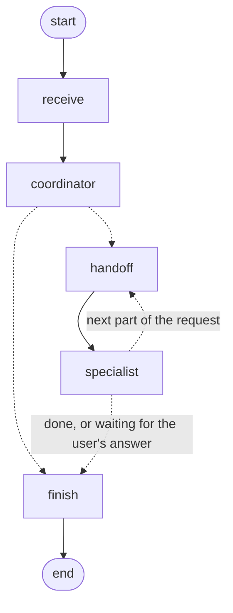
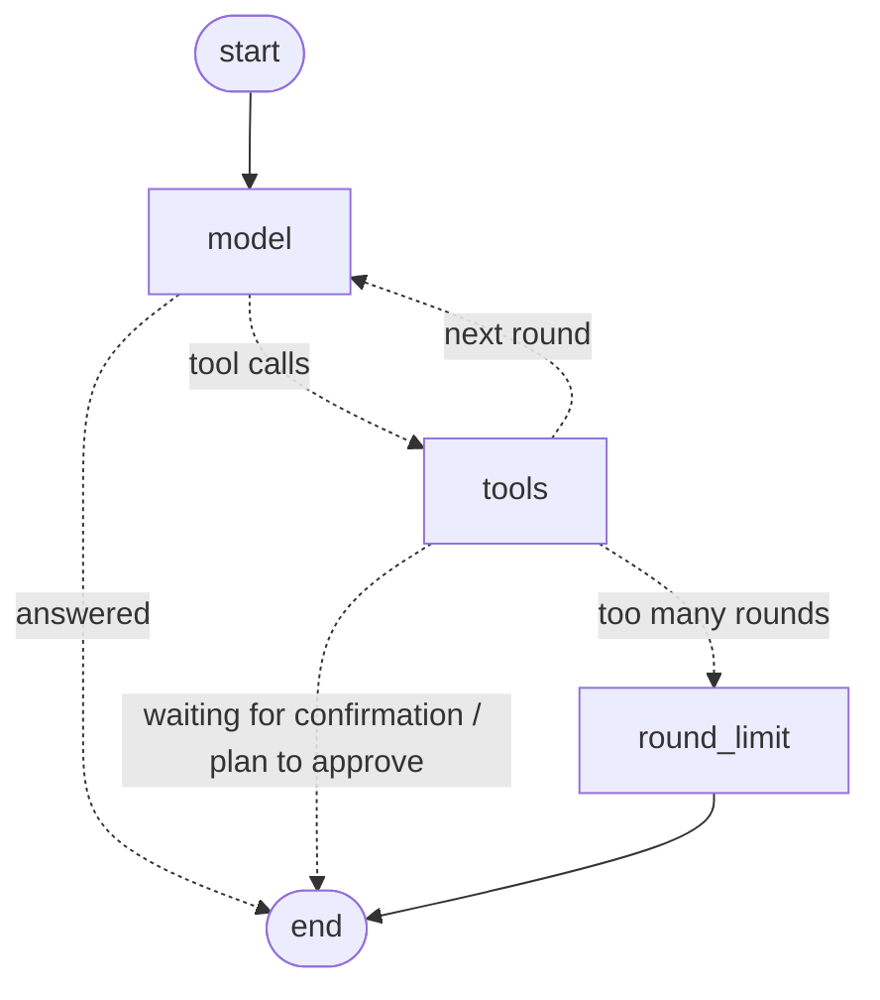

# Architecture


```
Browser (Next.js React UI, LiveKit client SDK)
   │  REST (JSON, cookie session)        │ WebRTC media
   ▼                                      ▼
Next.js server ─────────────────────► LiveKit SFU (self-hosted / Cloud)
 ├─ src/app/api/*        thin route handlers (validation, auth, error mapping)
 ├─ src/server/services  business logic, shared by REST and the AI agent tools
 ├─ src/server/auth      sessions, passwords, role checks
 ├─ src/server/providers (Phase 2+) calling / calendar / LLM / STT / embedding adapters
 └─ src/server/agent     (Phase 4) tool registry + orchestration loop
   │
   ▼
PostgreSQL + pgvector (Prisma)
```

## Principles

- **One service layer.** Route handlers and AI tools call the same functions in `src/server/services`. Every function takes an auth context and enforces permissions itself, so the LLM never gets broader access than the user and never gets raw database access.
- **Tenant isolation.** Every query is scoped by `organizationId` taken from the session, never from client input. Directory lookups return only active members of the caller's workspace.
- **No guessing people.** `resolveUser` returns `resolved` / `ambiguous` / `not_found`. Fuzzy (trigram) matches are *suggestions* only.
- **Provider abstraction.** Meetings store `provider` + `providerRoomId` + `providerMetadata`, so LiveKit identifiers are never assumed to map onto Teams resources.

## Authentication

- Passwords use bcrypt (cost 12). Login takes the same time for unknown emails, so timing can't reveal which accounts exist. Login is rate-limited per IP and per email.
- Sessions use a random 256-bit token in an `httpOnly`, `SameSite=Lax` cookie. Only its SHA-256 is stored. The session lasts 7 days and slides forward on use.
- Membership and role are re-read on every request, so removals and role changes apply immediately.
- `src/proxy.ts` is only an optimistic redirect. Real checks run in every page (`requireAuth`) and API handler (`authed`).
- State-changing requests with a foreign `Origin` header are rejected, as CSRF defence in depth.
- Roles: `OWNER > ADMIN > MEMBER` per workspace. Meeting-level roles (`HOST/COHOST/ATTENDEE`) arrive in Phase 3.

## Data model

Schema: [prisma/schema.prisma](../prisma/schema.prisma). All required tables exist from the first migration, plus `Session`, `AuditLog`, `Notification` and `TranscriptionJob` (idempotency key for duplicate-job prevention).

Deletion and retention:
- Deleting an organization cascades to everything under it.
- Deleting a meeting cascades to its participants, transcripts, chunks, summaries and recordings.
- Users who host meetings cannot be hard-deleted; deactivate them with `isActive=false`.
- Audit and agent logs survive actor deletion (`SetNull`).
- `Organization.transcriptRetentionDays` and `recordingRetentionDays` plus the per-row `expiresAt` columns drive the purge job (Phase 5).

Hand-written SQL in the init migration:
- The `halfvec` HNSW index on `TranscriptChunk.embedding`. HNSW on plain `vector` caps at 2000 dimensions; the embedding model outputs 2048.
- Prisma cannot express this index. **When generating future migrations, delete the `DROP INDEX "TranscriptChunk_embedding_hnsw_idx"` line Prisma adds.**

## Calling (Phase 2)

```
Browser ──https/wss :3443──► Caddy ──/rtc──► LiveKit :7880 (signalling)
   │                          └─────other──► Next.js :3100
   └──── UDP 50000-50200 / TCP 7881 ──► LiveKit (media, node_ip advertised)
LiveKit ──signed webhook──► POST /api/livekit/webhook ──► MeetingParticipant / Meeting status
```

- `src/server/providers/calling/types.ts` defines the provider-independent `CallingProvider` interface, with capability flags. `livekit.ts` implements it. `teams.ts` is a disabled stub that fails with `NOT_CONFIGURED` and doesn't pretend to work.
- **Joining.** `POST /api/meetings/:ref/join` checks workspace and meeting access, then creates the LiveKit room (idempotent). It returns a **10-minute** token scoped to that one room. LiveKit refreshes tokens for clients that stay connected. The calling provider is called *before* any database change, so an outage leaves no half-joined state.
- **Tokens never grant `roomAdmin`.** Mute, remove, co-host and end go through our API. The API checks meeting roles (`HOST > COHOST > ATTENDEE`) and then calls LiveKit's server API. People removed by the host get `removedAt` set and can't get a new token.
- **Access rule.** Members of the meeting's workspace can join with the link. Anyone else gets `NOT_FOUND`, so a meeting's existence isn't revealed. Explicit invitations arrive in Phase 3.
- **Webhooks.** These are verified with LiveKit's signed JWT, which includes a body hash. They record join and leave times, and mark a meeting `ENDED` when the room closes; empty rooms close after 5 minutes.
- **Chat.** Meeting chat uses LiveKit data channels. Messages are delivered in real time and are **not stored**.

## Scheduling, invitations & calendar (Phase 3)

- **Internal calendar.** Every invited person gets a `CalendarEvent`. It starts `TENTATIVE` and becomes `CONFIRMED` on accept or `CANCELED` on decline. These events are the source of truth for availability. External calendars (Google/Outlook) are not connected yet. Responses say so explicitly ("internal calendar only") rather than claiming that people are free.
- **Conflicts.** Scheduling and rescheduling check every participant for overlapping busy events. Back-to-back meetings don't count as a conflict. A conflict returns `409 CONFLICT` with structured `details.conflicts`, and the caller must resubmit with `allowConflicts: true` after asking the user. A meeting's old slot is ignored when it is rescheduled.
- **Privacy.** In conflict and availability results, titles are shown only for your own events and for meetings you also attend. Everything else shows as "busy".
- **Free-slot finder.** It walks the range in 30-minute steps and keeps slots where everyone is free and inside their own working hours (09:00–18:00 local time, Mon–Fri, DST-correct via `date-fns-tz`).
- **Time handling.** Instants are always stored in UTC. The client converts wall-clock time plus an IANA zone to UTC (`src/lib/time.ts`). The API accepts only ISO-8601 timestamps with an offset.
- **Invitations.** Only hosts and co-hosts can invite.
  - **Members:** they're invited by user id. That creates their participant row, an invitation, a calendar event (for scheduled meetings) and an in-app notification. Re-inviting someone the host removed lifts the removal.
  - **External people:** email invites only work if the workspace enables external invites. The person gets a single-use link; only its SHA-256 hash is stored. The link lasts 14 days, or until a day after the meeting if that is later. Accepting it creates a **GUEST** account. Guests can only see meetings they were invited to; they can't use the directory, schedule meetings or start them. If email isn't delivered, the host gets the link to share another way.
  - **LiveKit limit:** LiveKit cannot pull a user into a room. "Add Rahul to this call" therefore means invite and notify ("join now"); Rahul joins from the notification.
- **Notifications.** These are stored in `Notification` and shown in the top-bar bell, which polls every 20 seconds and on window focus.
- **Email.** Delivery is best-effort and reported per recipient as `sent`, `not_configured` or `failed`. Invites include an RFC 5545 `.ics` attachment. After an SMTP authentication failure, sending pauses for 15 minutes so a mailbox isn't locked out by repeated bad logins.

## AI assistant (Phase 4)

```
Chat UI ──POST /api/assistant/chat (SSE)──► agent loop (src/server/ai/agent.ts)
                                              │  ▲
                         OpenAI-compatible LLM │  │ tool results (JSON)
                       (Qwen via LLM_BASE_URL) ▼  │
                                         tool registry (src/server/ai/tools.ts)
                                              │  validated with zod, then calls…
                                              ▼
                              the same services as the REST API (permissions inside)
```

- **Provider-independent LLM layer** (`llm.ts`). It speaks the OpenAI-compatible `/chat/completions` streaming protocol and assembles tool calls from fragments. It retries 429/5xx and network errors before any text has streamed, and fails with a clear error after that. Any compatible server works by changing `LLM_*`.
- **Tools.** There are 18 typed tools, each with a zod schema that is also exported as JSON Schema. Tools call the existing services, so every workspace, meeting-role and guest rule applies to the AI exactly as it does to the UI. The model never gets database access. A tool's arguments can only name things through ids it obtained from earlier tool results, which are validated server-side.
- **Dates.** The model never does date arithmetic. `resolve_datetime` uses chrono-node on the user's wall clock in their IANA zone and converts to UTC with DST awareness. A missing time of day is flagged, so the assistant asks for it.
- **Confirmation policy.** Tools marked `sensitive` are `reschedule_meeting`, `cancel_meeting`, `remove_participant` and `end_meeting`. For these, the loop runs `preflight`, which validates and checks permission, then records a `PENDING_CONFIRMATION` action and **stops the turn**. The model can't confirm anything; only the requesting user can, via `POST /api/assistant/actions/:id`. Confirmations are claimed atomically so a double-click can't execute twice, expire after 15 minutes, and re-check permissions at execution time. Workspaces can opt in to auto-execution (`agentAutoExecute`, off by default).
- **Deterministic guards** (`guards.ts`) work regardless of how well the model behaves:
  - **Ambiguous people:** if `search_users` returned several matches, write tools refuse those ids until the user names one, by email or via the pick buttons, or a later search resolves uniquely.
  - **Emails:** `invite_by_email` only accepts addresses that appear in the user's own messages.
  - **Unbacked claims:** if the final reply says something was done ("I've invited…", "has been cancelled") without a matching successful tool call this turn, a correction is appended and logged.
- **Logging.** Every write or sensitive tool call is recorded in `AgentActionLog`, with arguments, result or error, status and duration.
- **Prompt-injection hygiene.** The system prompt tells the model that tool results and meeting titles are data, not instructions. The real protection is that no instruction can bypass the server-side checks above.
- **Conversations.** They're stored per user and workspace in `AgentConversation`/`AgentMessage`. Only the owner can read or continue one. Chats opened inside a call are attached to that meeting, so "this call" resolves.

## Transcription & summaries (Phase 5)

```
Participant browser (after consent)                     Server
 mic track ─► AudioWorklet ─► 16 kHz ─► voice-activity ─► WAV chunk ──POST──► consent + live checks ─► TranscriptionJob (idempotent)
                                        chunker (3–20 s, silence never sent)                                │ worker (SKIP LOCKED, retries)
                                                                                                           ▼
                                                     TranscriptSegment (speaker = uploader) ◄── STT (OpenAI-compatible, Granite)
Host: upload recording ─► browser decodes + splits ─► same job pipeline (speaker "Recording")
Host: import VTT/SRT/text ─► parsed directly into segments
```

- **No assumption that the calling SDK transcribes.** LiveKit provides no transcript. Each consenting participant's browser captures **their own microphone** after they give consent. That makes speaker attribution reliable without diarisation, and anyone who doesn't consent is never captured.
- **Consent and disclosure.**
  - **Who turns it on:** only a host or co-host can enable transcription, and a confirmation dialog explains what happens.
  - **Disclosure:** enabling it pushes LiveKit room metadata, so every participant immediately sees a red "Transcription is on" banner.
  - **Per-person consent:** each person's audio is captured only after they choose "Allow", and they can stop at any time.
  - **Server enforcement:** the server rejects chunks unless the meeting is live, transcription is on, and that uploader has consented.
  - **Audit:** consent changes are audit-logged.
- **Chunking.** The model has no segment timestamps and degrades past about 30 seconds. The browser therefore cuts audio at natural pauses (3–20 s), skips pure silence, and labels each chunk with its capture time, which the server sanity-checks against its own clock.
- **Jobs.** `TranscriptionJob` rows carry an idempotency key (`live:<meeting>:<user>:<clientChunkId>` or `rec:<recording>:<index>`), so retried uploads never duplicate text.
  - **Claiming:** the in-process worker (`src/instrumentation.ts`) claims jobs with `FOR UPDATE SKIP LOCKED`, so several instances can share the queue, and it reclaims jobs stuck in RUNNING.
  - **Retries:** transient STT errors are retried with exponential back-off, up to 5 attempts. Permanent failures are recorded and surfaced in the UI.
  - **Audio:** raw audio is deleted as soon as its text is saved.
- **Lifecycle and retention.** A transcript becomes `COMPLETED` once the meeting ends and no jobs are pending. `Organization.transcriptRetentionDays` sets `expiresAt`, and an hourly sweep deletes expired transcripts together with their segments, search chunks, summaries and action items. Hosts can delete a transcript manually, with confirmation.
- **Access.** Transcripts and summaries are visible only to the host and invited or joined participants who weren't removed. Being in the same workspace isn't enough.
- **Summaries.** These use a schema-constrained JSON output (vLLM `json_schema`) and map-reduce for long meetings.
  - **What the prompt asks for:** decisions only for explicit agreement, with suggestions kept separate; action items need a commitment; owners and due dates only as stated.
  - **Grounding:** every item must cite transcript segment numbers, and items citing no valid segment are **dropped**, with a warning logged.
  - **Owners:** an owner is linked to a user account only on an unambiguous participant name match.
  - **Due dates:** resolved with chrono relative to the meeting date.
- **Exports.** TXT, WebVTT, SRT and JSON.

## Meeting knowledge & question answering (Phase 6)

```
segments ─► chunks (~900 chars, timestamped "[mm:ss] Speaker: text" lines, 1-line overlap)
         ─► embeddings (OpenAI-compatible; nemotron-embed 2048-d) ─► TranscriptChunk.embedding halfvec + HNSW
question ─► scope ─┬─ named meetings that fit (≤ 24k chars): whole transcripts ("full" mode)
                   └─ otherwise: hybrid retrieval (pgvector cosine ∪ Postgres full-text, RRF) over meetings the user attended
         ─► LLM (schema-constrained JSON: answer with [E#] markers, sufficient_evidence, quotes)
         ─► verification ─► answer + citations (meeting, date, time, speaker, quote) or "not enough information"
```

- **Indexing.** The worker re-indexes any transcript whose `indexedAt` is null, every 10 seconds; live meetings are re-indexed at most once a minute. New segments, imports and replacements reset `indexedAt`. A compare-and-set on the transcript's `updatedAt` means text arriving mid-index triggers another pass. Deleting or purging a transcript removes its chunks.
- **Access control inside the query.** Both retrieval queries restrict chunks to the caller's workspace **and** to meetings they hosted or attended (and weren't removed from), in SQL. The model never sees text the user couldn't open. `hnsw.iterative_scan = relaxed_order` keeps vector recall high under that filter.
- **Hybrid retrieval.** Embeddings capture meaning ("what budget…" matches "fifty thousand dollars"). Postgres full-text search with OR semantics catches exact names and figures. Reciprocal rank fusion merges the two.
- **Grounding, enforced in code.**
  1. The model must cite excerpts and copy a short quote from each. A citation counts only if the quote really appears, after normalisation, in that excerpt. Its timestamp and speaker come from the matching transcript line, not from the model.
  2. A sentence whose citations all fail verification is removed.
  3. If nothing verifies, the user gets a fixed "the transcripts don't contain enough information" message.
  4. If the model marks its own evidence as insufficient but some citations verify, the answer is shown as **partial**, with a caveat. This was observed with near-duplicate meetings.
- **Decisions vs suggestions.** The prompt requires distinguishing them, and cross-meeting questions are answered in date order so changes are explicit. The live evaluation includes a meeting where a $50k increase is proposed and never approved, and the answer reports it that way.
- **Where it appears.** The Search page (answer plus matching passages, with a date filter), "Ask about this meeting" on transcript pages, and the assistant (`answer_meeting_question`, `search_transcripts`). Citation cards link to `/meetings/<code>/transcript#t=<ms>`, which scrolls to and highlights the moment.

## Known limitations (Phase 1)

- The rate limiter is in-memory, which is fine for a single instance. Use Redis or Postgres for multiple replicas.
- There is no email verification or password-reset email yet; both need SMTP.
- The dev HTTPS certificate is self-signed, so each browser shows a warning once. For production, put real TLS (e.g. Let's Encrypt via Caddy) in front of the app and LiveKit.

## Security & deployment (Phase 7)

See [SECURITY.md](SECURITY.md) for the controls and the review findings (all fixed, with regression tests), and [DEPLOYMENT.md](DEPLOYMENT.md) for the Docker images and production compose. Phase 7 changed behaviour in three ways:
- **Assistant confirmations.** The assistant now asks for confirmation before scheduling and inviting too, not only before destructive actions. Auto-execution is refused once text from other people (transcripts, titles, names) is in the conversation.
- **Ended meetings.** They can be reopened only by people who were part of them.
- **Webhook enforcement.** The LiveKit webhook removes anyone who joins a room without being an active participant of a live meeting.

## Call screen design

The call and its lobby are styled as a phone call, not a video-meeting grid (they used to look like Google Meet).

- **Stage** (`src/components/meeting/phone-stage.tsx`): one large circle per person, not counting the interpreter. Their camera plays inside the circle when it's on. A ring pulses while they talk, and the language they picked for the interpreter is shown under their name. Circles shrink as more people join. A screen share takes the middle, with the people as small circles under it. The list has the accessible name "People in this call", which the browser tests use.
- **Keys** (`phone-key.tsx`, `media-controls.tsx`): every control is a round key with a label underneath. The main row is Mute, Camera, Language, the big red **End** key, Captions and Noise. A smaller row has People, Chat, Transcript, Assistant, Ask by voice, Transcribe, Share, Details and, for hosts, End for all. Device choosers sit as a small badge on the Mute and Camera keys.
- **Interpreter panel** (`interpreter-ui.tsx`): the last three lines, centred under the avatars, with the latest translation in large type and the original underneath.
- **Styles** (`src/app/globals.css`, "Call screen" block): the `--call-*` colour tokens, the background gradient, the speaking-ring pulse (switched off under `prefers-reduced-motion`) and the `.phone-key` rules. These rules are `!important` inside a CSS layer, so they win over both Tailwind utilities and LiveKit's own button styles. The key sizes shrink below 480 px, so all keys fit on a phone.

## Calling & voice cancellation (Phase 8)

- **Calls are meetings.** A call is a meeting with `callType` VOICE or VIDEO and `isDirectCall`. Calls reuse every existing access rule, transcription, the assistant and summaries.
- **Ringing.** A `CallRing` row exists per callee: RINGING, then ACCEPTED, DECLINED, MISSED (after 45 s) or CANCELED. Every open page polls `/api/calls/incoming` every 3 seconds and shows a full-screen prompt with a Web Audio ringtone. The worker turns overdue rings into missed-call notifications. Hanging up or ending a call cancels outstanding rings. Inviting someone to a live meeting rings them, which is how "add people to a call" works.
- **Voice cancellation.**
  - **Standard:** the browser's noise suppression, echo cancellation and gain control.
  - **Enhanced:** runs the microphone through RNNoise (WebAssembly, MIT) as a LiveKit track processor at 48 kHz, so the **denoised** audio is what others hear.
  - **Off:** raw microphone audio.
  - **CSP:** adds `'wasm-unsafe-eval'` (WASM only, no JS `eval`).
- **Telephone numbers.** Calling them (PSTN) isn't possible without a SIP trunk or telephony provider. LiveKit SIP can add it later behind the same calling-provider interface.

## Voice assistant mid-call (Phase 9)

- **Two ways to talk to it.** The push-to-talk button in the call footer takes one command. The **Hey Mind** toggle (off by default, remembered per browser) listens continuously, but only to your own microphone and only while it is on.
- **Capture.** The same voice-activity chunker used for transcription cuts short utterances (0.3–12 s, 0.7 s pause) from your microphone, encodes 16 kHz WAV and posts it to `/api/voice/utterance`. Capture pauses while the assistant is thinking or speaking, so it never hears itself.
- **Speech-to-text.** NVIDIA Riva realtime ASR (`RIVA_REALTIME_URL`) is preferred: it handles English, Hindi and Spanish, with punctuation and word timings. It falls back to the OpenAI-compatible STT on transient errors. Each user's `preferredLanguage` selects the recognition language.
- **Privacy.** In wake mode the server transcribes the utterance, and if it doesn't start with "Hey Mind" (English or Hindi variants) the text is discarded without being stored or sent to the LLM.
- **Agent.** A triggered command runs the normal agent loop with `channel: "voice"`, which asks for short spoken answers in the user's language. All the Phase 4 guards and confirmations still apply. The voice user can't spell emails, so a spoken choice between same-name people is accepted by a distinctive title or department word ("the designer").
- **Confirmations by voice.** When an action needs confirmation, the reply ends "Say yes to confirm, or no to cancel." The next utterance is classified as yes or no (English and Hindi, including Devanagari) and resolved through the same single-use, owner-only `decideAction`. Yes/No buttons appear too. Anything else is asked again; the prompt expires after 20 s.
- **Speech output.** Qwen3-TTS: a voice is designed once from `TTS_VOICE_DESCRIPTION`, cached, and cloned for every reply, so the assistant always sounds the same. Qwen3-TTS has no Hindi, so Hindi replies (and any TTS failure) use the browser's own speech synthesis.
- **Transcription disclosure.** When the host turns transcription on, everyone in the call hears a spoken notice, as on phone networks, besides the banner.

## Call speech: NVIDIA Parakeet + Magpie (since 2026-10-24)

Calls (interpreter, live transcription, the in-call assistant, spoken replies) use two NVIDIA models in the same **12 languages**: English, Hindi, Spanish, French, German, Italian, Portuguese, Chinese, Japanese, Korean, Arabic, Vietnamese (`CALL_LANGUAGES` in `src/server/interpreter/constants.ts`).

- **Speech recognition: Parakeet** (`nemotron-asr-streaming`, multilingual cache-aware Parakeet, Riva realtime API at `RIVA_REALTIME_URL`). It supports about 40 languages and Hindi, but no other Indian language. `RIVA_LANG` in `src/server/providers/stt.ts` maps the call languages to its locales (Arabic is `ar-AR`).
- **Voice: Magpie TTS Multilingual** (NIM 1.10, `MAGPIE_TTS_URL`, `src/server/providers/magpie.ts`). `POST /audio/synthesize` returns a WAV (a 20 s reply in about 1.3 s); `POST /audio/synthesize_online` streams raw PCM (first audio in about 0.05 s). One voice per language: Louise, or Sofia for Arabic (`MAGPIE_VOICE` overrides). Sample rates 16000/22050/44100/48000 (24000 is rejected); a single response is capped at about 4 MB, so replies are spoken a sentence at a time. Text must be in the language's own script.
- **Fallbacks:** Qwen3-TTS, then the browser's voice. Translation (interpreter lines, the assistant's fixed spoken phrases via `translateText`) is done by Qwen.
- **Indic models: off.** The IndicConformer / indic-translate / indic-speak code stays and is used again only if `INDIC_*_URL` are set; the call language list stays at 12 either way. The supervisor starts the Indic tunnel only when those settings are present.
- **Wake phrase:** Parakeet writes "Hey Mind" in Hindi as one word, "हेमाइंड" or "हिमाइंड"; both are recognised.
- **Measured** (single test sentences): Hindi → French 1.4 s end to end (recognition 1.0 s, translation 0.3 s, voice 0.1 s); English → Hindi 2.3 s; Hindi → English 3.0 s. With the Indic models Hindi → English was 1.6 s, mainly because IndicConformer recognised Hindi faster (0.6 s).

## Interpreted calls: muting, whole sentences, recovering sessions (2026-10-25)

Three problems from a real call (`kof-yrmi-znu`: English and Hindi, transcription and interpreter on), and their fixes:

- **Hearing the original voice under the translation.** Browsers mute other-language speakers using the interpreter's *roster* (who speaks what, which voices exist). It used to be sent only when it changed, so a browser that missed it (reload, reconnect) never muted anyone. The interpreter now repeats it every 5 s (`ROSTER_REPEAT_MS`). With original voices on **Muted** (the default) the browser now **unsubscribes** from those speakers' microphone tracks instead of only setting volume 0, which some browsers (iPhone Safari) ignore. "Quiet" and "Full volume" still use volume.
- **Overlapping, choppy translation and transcript (fixed 2026-10-25, second call `auy-dnyx-mrb`).** Parakeet often sends **several results for one pause** (one per sentence it detects), answers late when the server is struggling, and doesn't answer a pause that held only noise. Matching results to pauses one-to-one gave lines wrong times (out of order, guessed zero-length spans) and glued pieces to the wrong sentence, so text appeared twice or overlapped. Now (`src/server/interpreter/riva-stream.ts`) **every result is placed by its word timestamps**: the stream records when each 100 ms of audio was sent (a session clock that also counts the padding), so each word maps back to when it was spoken. Each result is its own line at its real time, and words for audio already covered (`doneUntilMs`) are dropped, so the same speech can't appear twice. Pauses only drive the nudge and the watchdog.
- **Idle sessions.** While a speaker is muted no audio reaches Riva and the server drops the session (the "START flag" error). The stream sends 1 s of silence every few seconds while no audio flows (`KEEPALIVE_MS`).
- **"Hey Mind" split in two.** Since results are now separate lines, "Hey Mind" and the rest of the command can arrive as two lines. Speech that starts within 1.5 s of a "Hey Mind" line ending is the same command and isn't translated (`WAKE_CONTINUES_MS`). A punctuated "माइंड!" at the start also counts (Parakeet can drop "Hey"). Sentences from someone with "Hey Mind" on wait up to 6 s (was 3 s, `WAKE_HOLD_MS`) for their browser's verdict; it usually comes in 1–2 s, but under load a command could otherwise be translated to the other callers.
- **Transcription stopping mid-call.** While the interpreter is on it transcribes everyone (browsers don't upload, to avoid storing speech twice). In that call Riva's sessions broke ("must specify the START flag", "Internal error from Core") and the interpreter kept sending into the dead session, so all lines stopped. A Riva error now reopens the session at once; a watchdog also reopens it when 3 pauses in a row get no answer for 20 s (`WATCHDOG_MS`).
- **"The interpreter is joining the call…" for the whole call.** Browsers decided the interpreter was present only from "participant connected" events. Someone joining a call the interpreter was already in gets it in LiveKit's join response, with no such event, so their panel never showed the live lines. Presence is now re-checked on connect/reconnect and track events, every 2 s, and whenever a message from the interpreter arrives (`use-interpreter.ts`).
- Covered by `tests/unit/riva-stream.test.ts` and `e2e/interpreter-muting.spec.ts` (which now also checks the panel shows live lines, not "joining", after the listener reloads) (an 8-sentence English monologue to a Hindi listener: only the translation is received, also after a reload; 8 sentences → 8 lines).

## Phrase-by-phrase interpretation (2026-10-25)

Translation used to start only when the speaker paused (a whole sentence). Now it starts at each **short breath**, while they're still talking.

- **Why not earlier still:** the Parakeet server sends no text during speech (tested: interim results, server VAD and Riva's own end-of-utterance settings; the session API has no interim option). Text comes only for audio we commit. So the interpreter commits more often: at a 250 ms breath (`PHRASE_PAUSE_MS`), and in run-on speech at the next dip between words after 3.5 s (`PHRASE_MAX_MS`; a 40 ms quiet gap, so never mid-word). Measured: every word still recognised at 250 ms breaths; a phrase's text arrives ~0.1 s after it ends.
- **Context:** each phrase is translated as a continuation of what the same speaker said in the last 4 s (up to 3 phrases, with their translations), so phrases join into one sentence instead of restarting. Compared with whole-sentence translation (English → Hindi/Spanish, Hindi → English) the meaning held; one short phrase shifted slightly ("ठीक है" alone → "Alright").
- **Measured** (three 5–8 s sentences, each spoken as three phrases with 0.3 s breaths, English → Hindi): the listener starts hearing a sentence **3.4–5.0 s after it began, up to 3.8 s before the speaker finishes it**, against 7.9–9.4 s (after the speaker finished) sentence by sentence.
- **Not for "Hey Mind" listeners:** they keep the 800 ms pause and no phrase cuts (short cuts split commands, which then leak).
- **Transcript:** lines are phrase-sized.
- `INTERPRETER_MODE=sentence` turns it off (600 ms pause, whole sentences); `INTERPRETER_PAUSE_MS` overrides the phrase pause.

## Offline recognition: Parakeet on this host (2026-10-26)

The streaming Parakeet server returns a sentence's text only 0.8–1.1 s after the commit (measured from a client on
another host, 2026-10-26): a cache-aware streaming model finishes a stream chunk by chunk, after 1 s of padding gives
the last words their lookahead. Our voice detector already knows where each utterance ends, so for the languages in
`INTERPRETER_OFFLINE_ASR_LANGUAGES` (`en,hi`) the interpreter sends the whole utterance in one request to an offline
model instead (`src/server/interpreter/offline-asr.ts`): the last ~30 s of each speaker's audio is kept with its
arrival time, an utterance is cut out from 300 ms before speech started to 200 ms after it ended, and requests run
one at a time per speaker, so lines keep their order.

- **The model:** the same Parakeet family, NVIDIA Parakeet 1.1B RNNT multilingual, in Riva's offline mode on this
  host's GPU (`deploy/gpu-host`, `INTERPRETER_OFFLINE_ASR_URL`; DEPLOYMENT.md). It processes a whole utterance in one
  pass: **~50 ms** for a sentence, 60–140 ms for 6–16 s of audio.
- **Accuracy** (10 Hindi and 8 English meeting sentences voiced by Magpie, against the streaming server): every
  sentence right in both. Offline writes numbers as words ("दस बजे") and sometimes lowercases names ("friday");
  streaming once dropped "Priya". The model detects the language itself (the code is only a hint): one casual
  Hindi clip ("हाँ, शुक्रवार…") came back with its first word in Cyrillic.
- **Without the GPU host:** with `INTERPRETER_OFFLINE_ASR_URL` unset, the offline path uses the `STT_*` server
  (Granite): ~0.2 s, English only, lowercase without punctuation.
- Covered by `tests/unit/offline-asr.test.ts`.

## Interpreter latency, round 2 (2026-10-25, after the colleague's playbook)

Same 8-sentence test (English monologue → Hindi listener), two runs each:

| | Recognition | Translation | Voice | Queue | "Hey Mind" hold | Total |
|---|---|---|---|---|---|---|
| Before, "Hey Mind" off | 1.3 s | 0.58 s | 0.27 s | 0.7–1.3 s | – | 2.9–3.4 s |
| **Now, "Hey Mind" off** | 1.3 s | 0.50 s | **0.05 s** | **~0.5 s** | – | **2.3–2.5 s** |
| Before, "Hey Mind" on | 1.5 s | 0.58 s | 0.27 s | 0.8–0.9 s | 0.6 s | 3.7–3.9 s |
| **Now, "Hey Mind" on** | 1.5 s | **0.02 s** | **0.05 s** | 0.3–0.7 s | 0.6 s | **2.5–2.9 s** |

- **Magpie streamed in the interpreter** (`LanguageVoice.speak` → `streamMagpieSpeech` at 48 kHz): first audio 0.05 s instead of a whole file in 0.27 s. Each call reserves its place in the language's playback queue at once, so clauses play in order even if a later one is ready first; the audio is read ahead into memory so a waiting clause doesn't hold the connection.
- **Translation streamed, voiced clause by clause** (`translateLineStreaming`, `splitSpokenPieces`): each sentence (or a comma clause of 24+ characters) is shown in captions and voiced as soon as Qwen has written it. Gains most on long sentences with several clauses.
- **Translation prepared during the "Hey Mind" check** (`prepareTranslation`): nothing is shown, stored or played until the browser says the line wasn't a command; then the voice starts at once.
- **Catch-up speed** (`time-stretch.ts`, WSOLA): a sentence that had to wait for the previous one plays at 1.2× (waited > 1 s) or 1.3× (> 2.5 s), pitch unchanged. Magpie ignores SSML speaking rates (measured), so it's done on the audio.
- **Measured but not useful:** Parakeet's finishing time (~0.62 s) doesn't depend on the padding sent before the commit (0–1000 ms); the server sends no provisional text during speech; committing mid-sentence can get no answer at all (words lost), so it isn't used. The server is streaming-only (offline requests are rejected).
- **Remaining, on the GPU servers:** Parakeet offline (~0.6 s), a small translation model (~0.3 s), Parakeet's health. Written up for the server owner in [LATENCY-SERVER-REQUEST.md](LATENCY-SERVER-REQUEST.md).

## Interpreter latency work (2026-10-25)

Measured with an 8-sentence English monologue to a Hindi listener (two runs each; the voice queue alone varies 0.3–1.9 s between runs, so compare the parts):

| | Recognition | "Hey Mind" hold | Total |
|---|---|---|---|
| Before, "Hey Mind" off | 1.47 s | 0 | 3.55 s |
| Before, "Hey Mind" on | 1.51 s | 0.60 s (2.6 s in a real call) | 3.6–4.5 s |
| After, "Hey Mind" off | **1.31 s** | 0 | **2.9–3.4 s** |
| After, "Hey Mind" on | 1.47 s | 0.61 s | 3.7–3.9 s |

- **Shorter end-of-sentence pause, per speaker.** 600 ms (was 800) for speakers *not* listening for "Hey Mind": 0.2 s faster, still one line per sentence. Speakers listening for "Hey Mind" (and anyone before their browser reports its state) keep 800 ms (`WAKE_PAUSE_MS`): at 600 ms "Hey Mind, …?" was cut into pieces and pieces reached the other callers. `INTERPRETER_PAUSE_MS` still sets the normal pause.
- **Tried and reverted: holding only lines that look like a command.** Live recognition can miss "Hey Mind" entirely ("इस कॉल में कौन कौन है?"), and only the browser's check of the whole clip catches that, so every line from someone listening for "Hey Mind" still waits for that check.
- **Safer holds** (found while testing): the browser now tells the interpreter when it starts checking a clip (`checking`), and held lines wait for that check to finish (up to 15 s) instead of a fixed 6 s, so slow recognition can't let a command through. A command reported by the browser also covers anything the speaker said in the 15 s before it (`COMMAND_LOOKBACK_MS`), even when the interpreter's own result arrives after the verdict. Parakeet's usual mishearings of Hindi "Hey Mind" ("पेमाइंड", "पाइमाइंड", "फेमाइंड") are accepted; "पेमेंट" (payment) is not.
- **Remaining levers** (not done): translate and voice a held line while waiting for the verdict (most of the hold would overlap); a shorter voice queue when sentences come back to back; a faster translation model; Parakeet server health (slow results and dropped sessions).
- The "Hey Mind in Hindi" browser test now uses a clip with 12 s of silence before the command and 30 s after, so the looping fake microphone can't present a half-heard repeat (correctly translated as ordinary speech) during the test. Passed 8/8 (with the other "Hey Mind" interpreter test), and the full suite 22/22.

## Spoken replies: streamed, sentence by sentence

Speech is generated at roughly real time, so waiting for a whole reply's audio made long answers start 10–20 s late. Replies are now spoken as they're produced.

- **Streaming voice** (`streamIndicSpeech` in `src/server/providers/indic.ts`, `POST /api/voice/speak` with `stream: true`): opens indic-speak's `WS /v1/stream` and passes the PCM chunks straight through as `audio/L16; rate=24000`. The first audio arrives in about 0.4 s whatever the length; generation runs ahead of playback. The response starts only once the first audio is in, so if streaming fails the endpoint can still answer with the whole-file voice (Qwen3-TTS) instead. Languages indic-speak doesn't cover (e.g. Spanish) always use the whole-file voice.
- **Player** (`src/lib/audio/speech-player.ts`, `SpeechPlayer`): splits text into sentences (`takeSentences`; very short ones are joined to the next, and a sentence at the very end of streaming text waits in case it's still growing), requests one sentence ahead of the one playing, and schedules the PCM chunks back to back on Web Audio. If the server has no voice it uses the browser's speech synthesis. `stop()` cancels everything at once.
- **Assistant chat** (`assistant-chat.tsx`, `use-voice-io.ts`): the answer is fed to the player while it streams in, so the first sentence plays while the assistant is still writing the rest. Questions asked by voice are always answered aloud and sent with `channel: "voice"` (short, plain answers); typed questions are read aloud only with **Speak replies** on.
- **Hands-free mic in the chat**: the mic button stays on until it's clicked again. Each pause sends what was said. While the assistant is working or speaking (and 0.4 s after), the mic input is ignored, so it never hears itself. A spoken yes/no while an action or plan waits for approval answers it, like pressing the button.
- **In calls** ("Hey Mind"): the browser sends `streamSpeech=1`, the server returns the reply text without synthesising it, and the browser streams it with the same player.
- **Measured** (English, through Caddy): a 72-word reply's first audio went from 21.8 s to 0.39 s; from the end of a question to the first audio went from 7–39 s to 2–6 s. What remains is the assistant itself (routing, tools, the model).

## Live translated captions (Phase 10)

- **Source.** Captions come from the same consented live transcription: no new audio is captured. Each `TranscriptSegment` now stores the `language` it was recognised in (Riva reports it; the fallback STT leaves it empty).
- **Translation.** Each viewer chooses Off, "As spoken" or a language (their profile language is listed first; the choice is remembered per browser). `GET /captions` returns the recent lines; lines not already in the viewer's language are translated by the LLM in batches of up to 12, with structured JSON output and temperature 0. The prompt keeps names and numbers, and treats lines as data, never instructions.
- **Cost control.** Translations are cached in `SegmentTranslation` (segment + language), and an in-process single-flight map means viewers polling at the same moment share one model call. Ten Hindi viewers cost one translation per line.
- **Failure behaviour.** If the model fails or returns something implausible (empty, or far longer than the source), the original line is shown untranslated and nothing is cached, so it's retried on the next poll.
- **Live push (2026-10-26).** In LiveKit calls the server agent joins whenever transcription **or** interpretation is on. It transcribes every consenting speaker with streaming Parakeet and sends each line on the data channel (topic `interpreter`, message `line` with `startMs`) the moment it's recognised; translations follow as `translation` messages. The transcript panel and captions show these at once (`use-call-feed.ts`): a caption in another language waits 400 ms for a pushed translation, then asks `GET /captions`. Polling remains only as a fallback (panel every 15 s, captions every 6 s). With interpretation off the agent only transcribes: it publishes no voice and translates nothing. The browser's chunk upload below is used only when the agent isn't in the call. Measured end of speech → text on the listener's screen: **0.9 s** median for both panel and captions (was 4.4 s and 2.1–2.8 s).
- **Latency (upload fallback).** Live capture cuts audio into 2–12 s chunks at pauses (was 3–20 s). Measured with the real services: speech appears as a translated caption a few seconds after it's spoken; a single translation takes about 0.5 s and a batch of three about 1.9 s.
- **Display.** Up to three lines over the video for 12 s each, with the speaker's name, a "translated" marker and the original on hover. Lines carry the right `lang` attribute for screen readers.

## Reminders, task assistance and post-call follow-up (Phase 11)

- **Reminders.** `Reminder` rows are always delivered in-app, and by SMS when requested. The worker checks every 15 s and claims each reminder atomically (`PENDING → SENDING`), so several app instances never double-send. A reminder claimed but not finished within 5 minutes is retried. An SMS failure is recorded on the reminder; the in-app notification still arrives.
- **SMS.** `SmsProvider` has two implementations: **Twilio** (REST API, enabled by `TWILIO_*`) and a development **outbox** that records messages without sending them (Settings → Text messages). Every message is logged in `SmsMessage`. SMS only ever goes to the user's own number, after it is verified with a 6-digit code: SHA-256 hashed, 10-minute expiry, 5 attempts, 3 sends per 10 minutes. Changing the number un-verifies it and turns SMS reminders off.
- **Food, cabs and tables.** A `CommerceProvider` interface with a **sandbox** implementation: a fixed catalogue of six fictional Bengaluru restaurants, deterministic cab fares (the same in both directions) and table slots that fill up. Every order or booking is a sensitive assistant tool. Before anything happens, the user confirms a summary of the items, total, route, fare or time, labelled "Sandbox — no real order is placed and nothing is charged". The prompt requires the assistant to ask for addresses, never guess them. Real providers (Swiggy, Zomato, Uber, Ola and others) can be added behind the same interface once partner APIs and payment are arranged.
- **The meeting you just agreed on.** `get_recent_conversation` returns the last N minutes of the live transcript (participants only, marked as untrusted text). The assistant extracts the agreed topic, time and people, then goes through `resolve_datetime`, `search_users` and `create_meeting`, which still needs confirmation. If no time was agreed, it asks.
- **Post-call follow-up.** Every 30 s the worker looks for meetings that have ended with a final transcript. It summarises each one once (with the host's permissions) and notifies every participant. Owners of action items are told, and each item with a due date gets a reminder at 09:00 on the due day in the owner's time zone, by SMS if they opted in. If the AI is down, it retries once after 10 minutes.
- **Claim guard.** It now also catches "ordered", "reserved", "booked" and "set a reminder" when the matching tool didn't succeed.

## Orchestration on LangGraph
The agent team runs on **LangGraph.js** (`@langchain/langgraph` 1.4.21, `src/server/ai/agent-graph.ts`). Each assistant turn is one run of the turn graph. Each specialist's work is one run of the specialist graph.





- **receive**: validates the message, loads the conversation, and stores the user's message. **coordinator**: Qwen picks the specialists and their tasks. **handoff**: records and announces the handoff, and builds that specialist's prompt. **specialist**: runs the specialist graph. **finish**: closing notes and the guard against claimed-but-not-done actions.
- **model**: one Qwen call with only that specialist's tools (streamed). **tools**: read tools run at once; sensitive tools are checked and become confirmation cards; a Planner proposal becomes one plan card.
- **Human approval stays outside the graph.** A confirmation or plan ends the run, and the user's Confirm/Approve later runs it (`decideAction`, `decidePlan`). The conversation stays open meanwhile, approvals expire after 15 minutes and work once, and voice yes/no works the same. No checkpointer is used: conversations are already stored in Postgres.
- The steps live in `agent-core.ts` and are shared with the original loop, which `AGENT_ENGINE=classic` switches back to. All unit and integration tests pass on both engines. The live evaluations (22, against Qwen 27B) and all browser tests pass on LangGraph.
- Model calls go through our own OpenAI-compatible client (`llm.ts`) inside the graph nodes, not LangChain model classes. That keeps streaming, retries and the test fakes unchanged. LangSmith tracing isn't enabled, so no conversation data leaves the servers.

## Agent team (Phase 13)

The assistant is a **coordinator plus specialist agents** ([src/server/ai/agents.ts](../src/server/ai/agents.ts)).

| Agent | Handles | Tools |
|---|---|---|
| Meetings & calls | scheduling, availability, invitations, calling, live-call control, "the meeting we just agreed on" | 20 |
| Meeting knowledge | transcripts, summaries, action items, cited Q&A, search | 10 |
| Food & dining | restaurants, menus, food orders, table reservations | 8 |
| Travel | cab fares and bookings | 5 |
| Reminders | personal reminders (in-app/SMS), action-item reminders | 7 |
| General | greetings, "what can you do", anything else (also the fallback) | all 37 |

1. **Coordinator.** One LLM call with structured output (`route_request`) reads the latest message and a compact view of the conversation: user and assistant text, earlier handoffs, pending confirmations, and steps still waiting. It returns 1–3 ordered steps `{agent, task}`. Each task repeats every detail the user gave. If the reply is unreadable or the call fails, it routes to the General agent, so the assistant never stops working.
2. **Specialists.** Each step runs the same tool loop as before (`runSpecialist` in `agent.ts`). The system prompt is the shared one plus a TEAM ROLE section with the agent's focus, its task and what teammates are doing, and the model is offered **only that agent's tools**. A call to another agent's tool is refused (`UNKNOWN_TOOL`) and never runs.
3. **Shared memory.** All agents read and write the same conversation, so later agents see earlier ones' results (the dining agent books the table *after* the meeting the meetings agent just proposed). The guards (same-name people, user-typed emails, untrusted text, unbacked claims) and the confirmation flow therefore work unchanged across the team.
4. **Waiting.** If a specialist ends by asking the user something, the remaining steps are stored as "waiting" and announced. On the next message the coordinator sees them and routes them again once the answer arrives.
5. **Records.** Handoffs are stored as `SYSTEM` messages (shown as agent badges in the chat), and each `AgentActionLog` row records the acting `agent`.

## Call transcription, summary and delivery (Phase 16)

**Speakers in recordings.** The browser still uploads a recording in ≤20 s pieces, but now declares how many pieces and the spoken language.
- With Riva available, each piece is only stored. Once all have arrived, one job transcribes the **whole call in one Riva session with speaker separation** (Sortformer), so "Speaker 1" is the same person throughout.
- The audio is sent in pieces cut at quiet moments, each followed by 1 s of silence and a commit. Riva's timestamps include those silences and are mapped back.
- Riva's word list can miss words, so each sentence keeps its full text and takes its speaker by majority vote of its words. Consecutive lines by one speaker with gaps under 1.5 s are merged into turns.
- If speaker separation fails three times, every piece is transcribed without speakers, so nothing is lost. Audio is deleted afterwards.
- On the 90 s sample call, all 20 lines were attributed correctly, in about 13 s.

**Naming speakers.** Hosts and co-hosts can rename "Speaker 1" (optionally linking a participant); the summary can then be regenerated with real names. The Speakers card shows talk time, share and turns per speaker.

**Sample call.** `public/samples/sample-call.wav` is a 90 s two-voice business call generated with Qwen3-TTS: two designed, then cloned, voices. "Try a sample call" on the Meetings page creates an ended call record and opens the upload with the sample ready.

**Automatic summary.** The existing post-call step summarises the call once the transcript is final: key discussion points, decisions, action items with owners and due dates, and open issues, all cited to transcript times.

**Delivery** (`services/summary-delivery.ts`). Every participant gets the summary:
- **in the app**, always: a notification plus the summary page;
- **by email** unless they turned it off: plain text and HTML (escaped);
- **by SMS** only if they asked and have a number verified with the current provider. Links, emails and phone numbers are stripped from the summary text, and only the app's own link is added.

Each person × channel attempt is stored in `SummaryDelivery` and shown in the delivery panel with status (sent, outbox, failed, off) and time. Hosts can resend. Emails are logged in `EmailMessage`. With `EMAIL_DEV_OUTBOX=true` (development) they're recorded instead of sent, and readable under Settings → Messages. Without SMTP or the outbox, email delivery is reported as failed, never hidden.

## AI interpreter in the call (Phase 15)

Real-time voice translation for app-to-app calls ([src/server/interpreter/](../src/server/interpreter), process: `npm run interpreter`).

1. **The interpreter is a participant.** A separate Node process uses the LiveKit Node SDK (`@livekit/rtc-node`) to join every live call where a host has switched interpretation on, as "MeetMind Interpreter" (identity `agent-interpreter`).
   - The webhook lets that identity stay only while interpretation is on.
   - Users can't obtain it, because their tokens always carry their own user ID.
   - It joins only rooms with people in them, leaves 30 s after the last person does (so the call can end normally), and rejoins if it's dropped.
2. **Listening.** For each participant who gave transcription consent, it subscribes to their microphone at 16 kHz mono.
   - A voice-activity detector finds the end of each sentence: an 800 ms pause by default (`INTERPRETER_PAUSE_MS`), with a noise floor taken from the quietest 200 ms of the last 5 s.
   - Audio streams to a long-lived **Riva realtime** session per speaker, in 100 ms messages. 10 ms frames made Riva about 4× slower.
   - At each pause it sends 1 s of silence plus a commit, which makes the streaming model finalise the sentence, about 0.5 s later. If nothing returns within 0.9 s, it repeats once.
   - **Matching results to pauses.** Each result is matched to the oldest unanswered pause. A pause containing only noise (a cough, a click) gets **no** result from Riva, so pauses left unanswered for more than 2.5 s (`STALE_COMMIT_MS`) are dropped when the next result arrives, and an empty result still answers its pause. Before this fix (2026-10-24), each noise pause shifted every later English line onto an older pause's time: lines landed among earlier lines (looking like repeats), and measured latency grew to minutes (one real call averaged 21 s English→Malayalam and 102 s English→Urdu, against about 2 s for Indian languages, whose recogniser timestamps each sentence itself). Covered by `tests/unit/riva-stream.test.ts`.
3. **Translating and speaking.** Each sentence:
   - is saved as a `TranscriptSegment`, so transcripts, summaries, captions and search all just work;
   - is translated into every other language present, using a fast plain-text single-line call (about 0.5 s, cached in `SegmentTranslation`, so captions reuse it);
   - is synthesised by Qwen3-TTS. Hindi uses its "Auto" mode, verified intelligible by transcribing it back with Riva's Hindi model.
4. **One audio track per language.** The agent publishes a track per language in the call (`interpreter-hi`, `interpreter-en`, …) and plays lines strictly in order. Each browser subscribes only to its own language's track and turns other-language voices down (muted, quiet underneath, or full volume).
5. **Data channel.** Over topic `interpreter` the agent sends the roster (who speaks what, which voices exist), each line, its translations, and its latency. The panel in the call shows them, along with the average latency for that listener.
6. **Latency.** It's measured per line, from the speaker's last voiced audio frame to the moment the translated audio starts playing into the call, with the speech-recognition, translation, voice and queue parts. It's stored in `InterpretationEvent`, and shown in the call and on the meeting page (average, median, 95th percentile, by direction). Network delivery to the listener (WebRTC, typically under 0.2 s) comes on top.
7. **Conference calls.** Every listener hears every other person in their own language. Each additional language adds one translation, one voice and one track per sentence, all in parallel.

Measured end to end with the real models (browser tests, synthetic voices, shared GPU servers):

| Condition | English→Hindi | Hindi→English |
|---|---|---|
| Interpreter tests alone | 1.8–3.1 s | 2.5–3.4 s |
| While the whole test suite also loads the same AI servers | 2.7–4.7 s | 4.9–5.6 s |

Typical breakdown: 0.8 s pause (configurable), recognition 0.5–0.7 s for English and 1.1–2.5 s for Hindi after the pause, 0.5 s translation, 0.5–0.8 s voice. The biggest remaining levers are the Hindi recognition model, streaming TTS (start speaking before the whole sentence is synthesised), a shorter pause, and dedicated GPU capacity.

## Planner agent (Phase 14)

The **Planner** is the 8th agent ([agents.ts](../src/server/ai/agents.ts), [plans.ts](../src/server/ai/plans.ts)). The coordinator sends it requests phrased as planning or organising an event ("plan a team dinner…", "organise lunch for the client visit…"). Explicit multi-part instructions still split across specialists.

1. **Research only.** The Planner's tools are all read-only (dates, people, calendars, free slots, restaurants and table slots, cab fares, existing bookings), plus `propose_plan`. It can't act. Its instructions include the exact argument list of each plan action, generated from the tools' own schemas.
2. **Proposal.** `propose_plan` lists up to 6 actions (`create_meeting`, `invite_participants`, `reserve_table`, `order_food`, `book_cab`, `create_reminder`) with concrete arguments and optional `depends_on`. The server runs each step's own preflight, the same permission and guard checks as a single confirmation, which produces an exact description. An invalid step goes back to the Planner to fix. A valid plan is stored as an `AgentPlan` and shown as one plan card.
3. **One approval.** `POST /api/assistant/plans/:id` with `approve` or `reject`. Only the requester can decide, it's claimed atomically, and it expires after 15 minutes. Steps run in order through the normal services, which re-check permissions. A step whose prerequisite failed is skipped. Every executed step is written to `AgentActionLog` with `agent: "planner"`.
4. **Adaptation.** If anything fails or is skipped, the Planner gets the outcome (what's done, what isn't, and why). It researches alternatives and proposes a revised plan containing only the replacement steps, linked by `parentId`. The revision needs approval again; at most 2 revisions.
5. **No invented places.** Cab pickup and drop-off points and delivery addresses must come from the conversation: what the user said or what a tool returned (`placeIsGrounded`). This is enforced in the tools' preflight, so it applies to plans and to the specialists.

Also fixed in this phase:
- **Handoff note.** When an agent follows another, it gets an explicit coordinator note, so it starts its own task instead of summarising the previous agent's.
- **Riva timing.** Speech recognition waits for the remaining utterances while the recognised words end well before the end of the audio. The server had started returning results 1.5 s apart.

## Hardening (Phase 12)

- **SMS modes.** There are three: Twilio (real), the development outbox (only with `SMS_DEV_OUTBOX=true`), or off. Each user records the provider their number was verified with (`phoneVerifiedVia`). SMS is sent only when that matches the provider in use (`canTextUser`).
- **Confirmation.** Confirmation is now required for reminders too. Voice turns never auto-execute.
- **Ringing.** Ring states and re-ringing need the host or a current participant. Accepting re-checks that the call is live.
- **Concurrency.** Table reservations take a Postgres advisory lock per restaurant and slot.
- **Browser.** The noise control applies changes one at a time in order and keeps the selected device. The incoming-call prompt is a Radix alert dialog. Polling pauses in hidden tabs.

## Known limitations (Phase 6)

- **Verification proves the quote exists, not that it's about the right subject.** In testing, with several near-identical meetings that differed only in a project code, the model once cited the right sentence from the wrong meeting. Real meetings are usually more distinct, and every citation shows its meeting title, but users should glance at the sources.
- **Keyword search scale.** It computes `to_tsvector` on the fly, which is fine for thousands of chunks. Add a GIN expression index (and strip Prisma's drop of it, like the HNSW index) at larger scale.
- **Full-transcript mode cap.** It's used only when the named meetings fit in about 24k characters; larger scopes fall back to retrieval, so very broad questions may miss details.
- **Model-dependent quality.** It depends on the configured LLM. Re-run `LLM_LIVE=1 npx vitest run tests/live` after changing models.

## Known limitations (Phase 5)

- **No recording of calls themselves.** LiveKit Egress isn't deployed. Post-meeting transcription works from a recording the host uploads; it's decoded in the browser and capped at 2 hours.
- **Uploaded recordings have no speakers.** A single mixed recording isn't attributed, since there's no diarisation model.
- **Speech output quality.** The Granite model outputs lowercase text without punctuation. Summaries handle this fine, but the raw transcript reads plainly.
- **Live latency.** Text appears roughly 3–20 seconds after speech, depending on pauses, plus processing time.
- **Background noise.** Constant loud noise above the speech threshold may be uploaded. The STT model returns no text for it, so it costs only bandwidth.

## Known limitations (Phase 4)

- Transcript, summary and question-answering tools arrive in Phases 5–6. Until then the assistant says these aren't available.
- The assistant uses whatever model is configured. The live evaluation (`tests/live`) passed 10 of 10 spec scenarios on `qwen3.8-27b`, but other models should be re-evaluated.
- The rate limit is 20 assistant messages per minute per user, kept in memory.

## Known limitations (Phase 3)

- Availability uses only MeetMind's calendar. A Google/Outlook provider abstraction would plug in at `CalendarEvent.provider`/`externalEventId`; it isn't implemented yet.
- Notifications use polling rather than push (WebSocket/SSE).
- Working hours are fixed at 09:00–18:00, Mon–Fri. They aren't configurable per user yet.
- Recurring meetings aren't supported.

## Known limitations (Phase 2)

- No recording yet. LiveKit recording needs the separate Egress service, which isn't deployed here. Transcription comes in Phase 5 via explicit audio capture and speech-to-text.
- Meeting chat isn't persisted.
- Remote participants need network access to the LiveKit media ports (TCP 7881, UDP 50000–50200). Users behind strict firewalls will need a TURN server (LiveKit's built-in TURN/TLS can be enabled in `livekit.yaml` with a domain + certificate).
